# Chatr

Voice meetings for your team, on your own server. A host starts a meeting and shares a link; people join from a
browser, a phone or the desktop app. Voice comes first, and when people want it there is a camera, a text chat, a
shared whiteboard and screen sharing. It keeps working on a bad connection.

**See how it looks: [chat.viipers.com](https://chat.viipers.com).** Starting a meeting needs a host account, which only
the administrator of a server can create, so that page is for looking around; [deploy your own](#deploy) to host
meetings.

## What to expect

### Getting in

<table>
<tr>
<td width="33%" valign="top">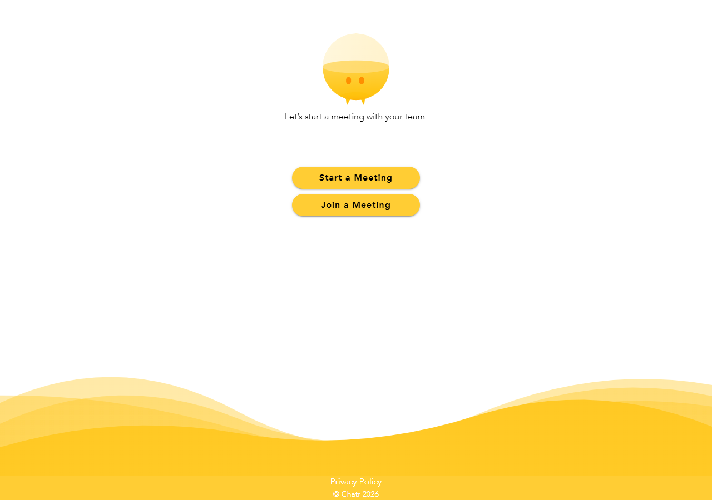<br><b>Home</b><br>Hosts start a meeting, everybody else joins one.</td>
<td width="33%" valign="top">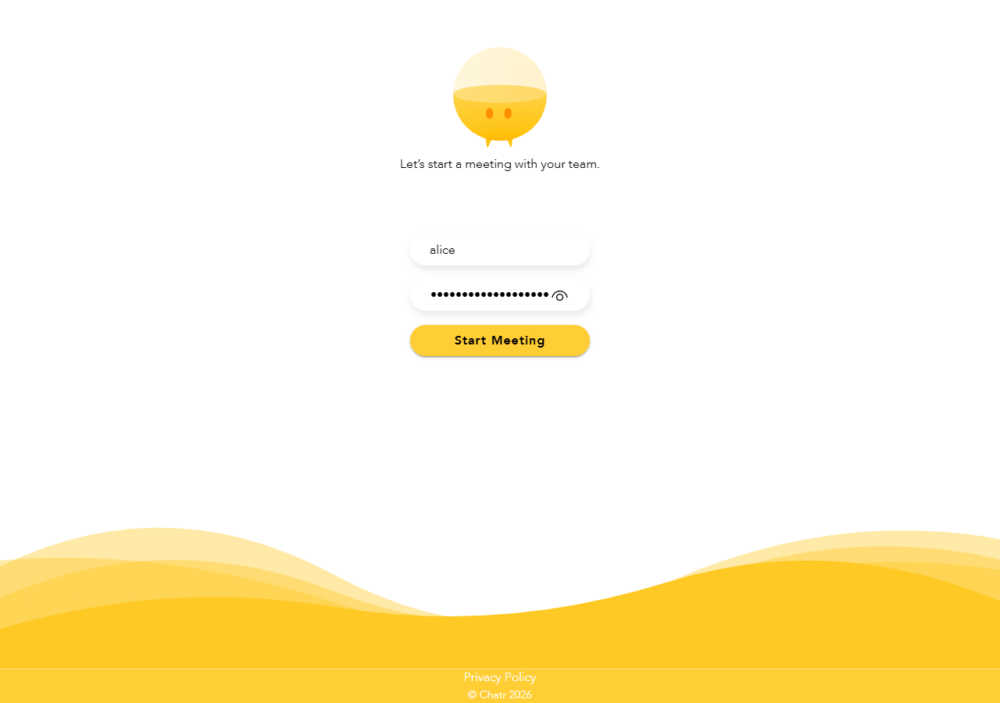<br><b>Host sign-in</b><br>Only hosts created by the administrator can start a meeting.</td>
<td width="33%" valign="top">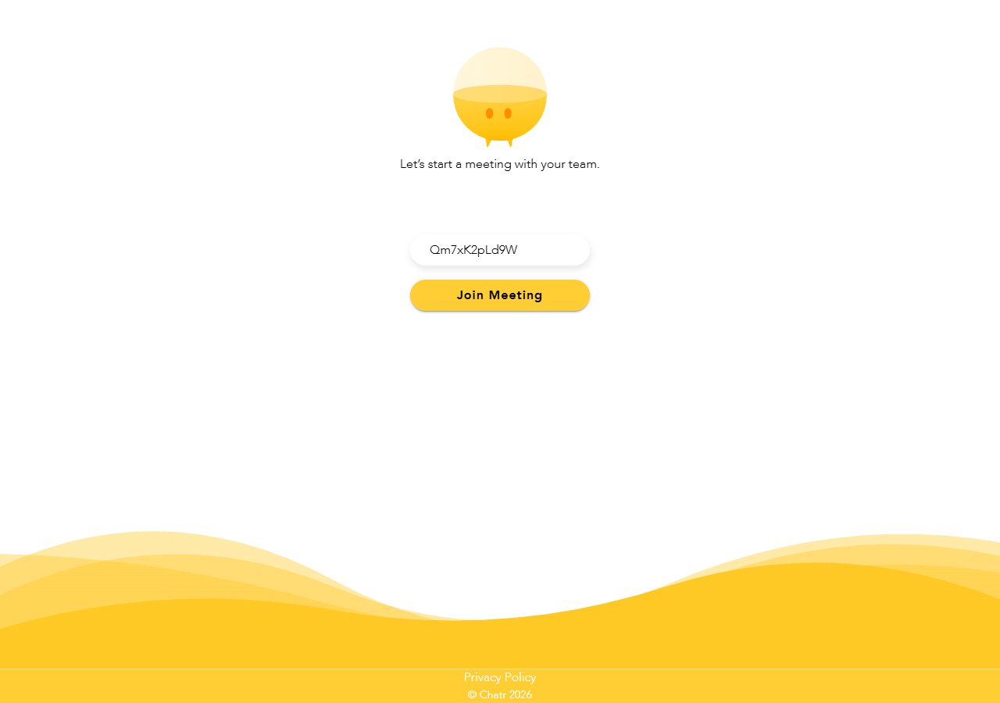<br><b>Join</b><br>Open the invitation link, or type the meeting id. No account needed.</td>
</tr>
</table>

### In a meeting

Meetings are voice first. Everybody who has no camera on is an avatar with a label (**You**, **Host** or
**Participant**, or the name they typed before joining: it is optional), never a black square. Calls go directly between the participants, so nothing is recorded or stored on the server.

<table>
<tr>
<td width="33%" valign="top">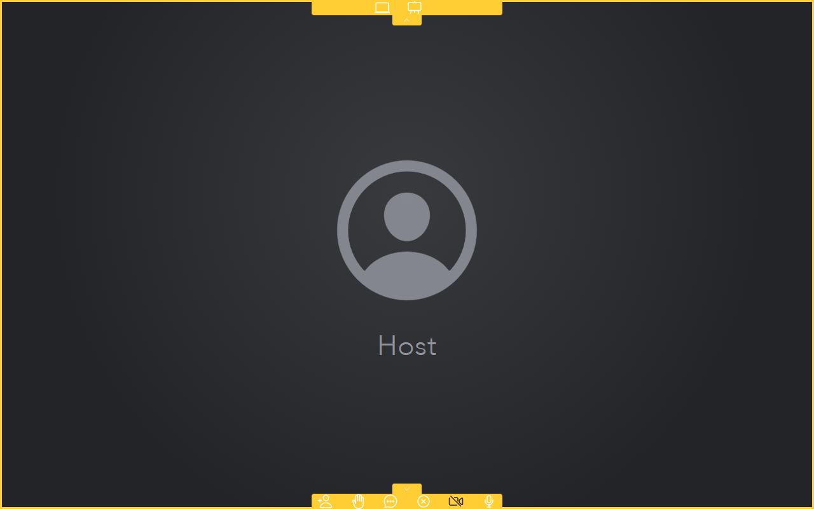<br><b>Voice only</b><br>The menu at the bottom: invite, raise hand, chat, end meeting, camera, microphone.</td>
<td width="33%" valign="top">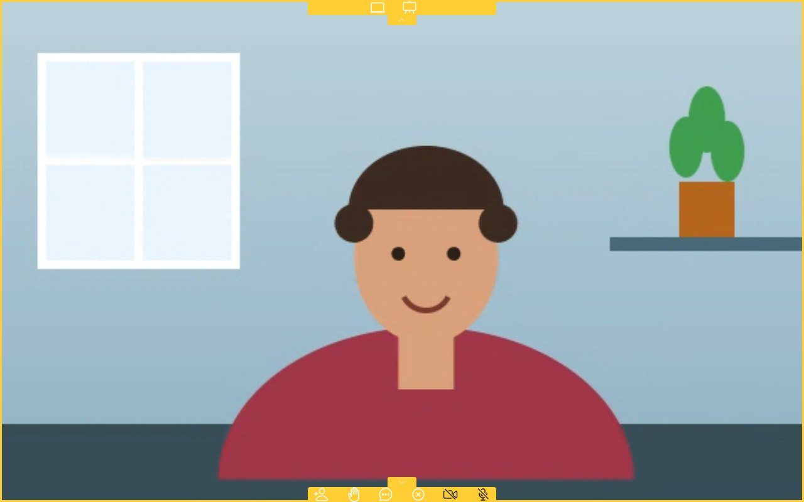<br><b>Camera on</b><br>The camera is off until you switch it on. Everybody sees it, people who join later too.</td>
<td width="33%" valign="top">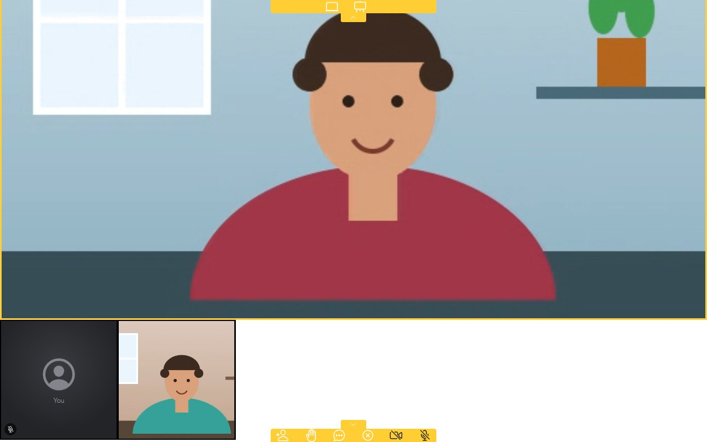<br><b>Participants</b><br>Scroll down for everybody else. A small slashed microphone shows who has muted themselves.</td>
</tr>
</table>

The buttons show their state: a slashed microphone or camera means it is off. Tap to switch.

### Chat, whiteboard and screen sharing

<table>
<tr>
<td width="50%" valign="top">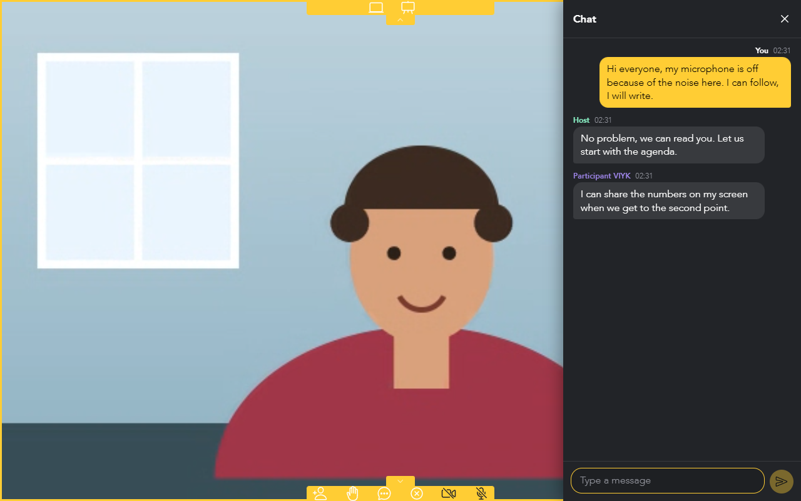<br><b>Chat</b><br>For people who cannot or do not want to speak. Messages show "Sending…" while the connection is bad and arrive by themselves; a refused one offers a retry.</td>
<td width="50%" valign="top">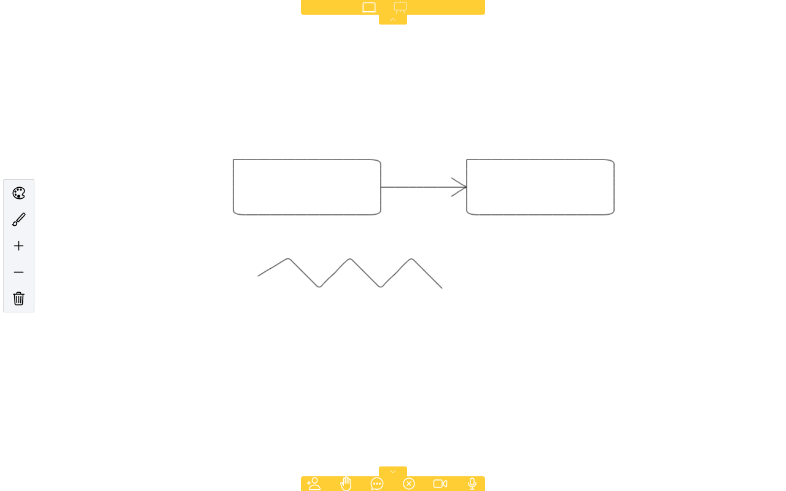<br><b>Whiteboard</b><br>Draw together; colours and brush sizes are on the left. Everybody sees it as it is drawn.</td>
</tr>
</table>

**Screen sharing:** share a screen or a window from the top bar; tap the shared picture in the row to make it the main one.

### Administration

The first time the app starts, the administrator is created (that is only possible once). The administrator creates the
hosts, who sign in with the credentials that are copied to the clipboard, and edits the privacy policy shown to everybody.

<table>
<tr>
<td width="25%" valign="top">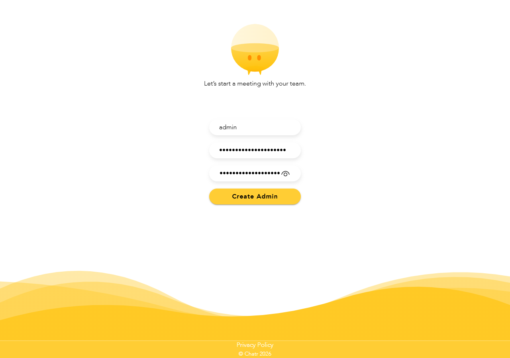<br><b>First run</b><br>Create the administrator.</td>
<td width="25%" valign="top">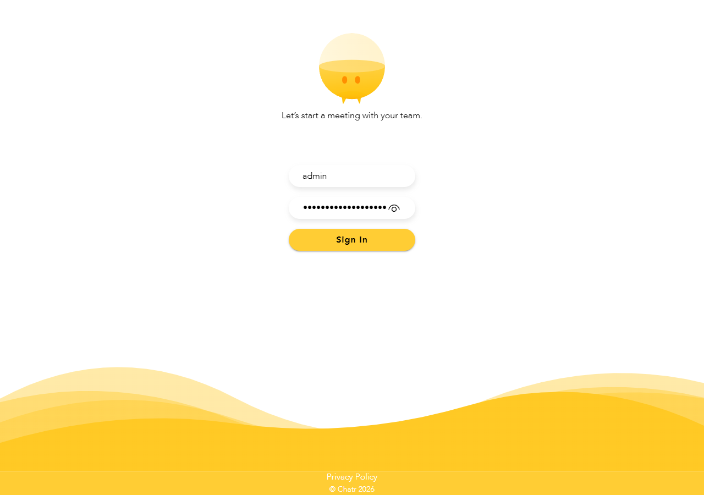<br><b>Sign in</b><br>Throttled and locked after repeated failures.</td>
<td width="25%" valign="top">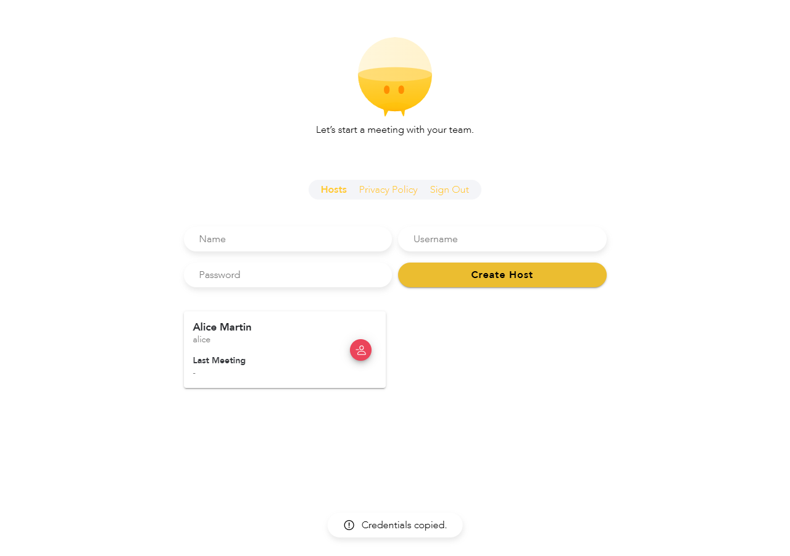<br><b>Create a host</b><br>The credentials are copied, ready to send.</td>
<td width="25%" valign="top">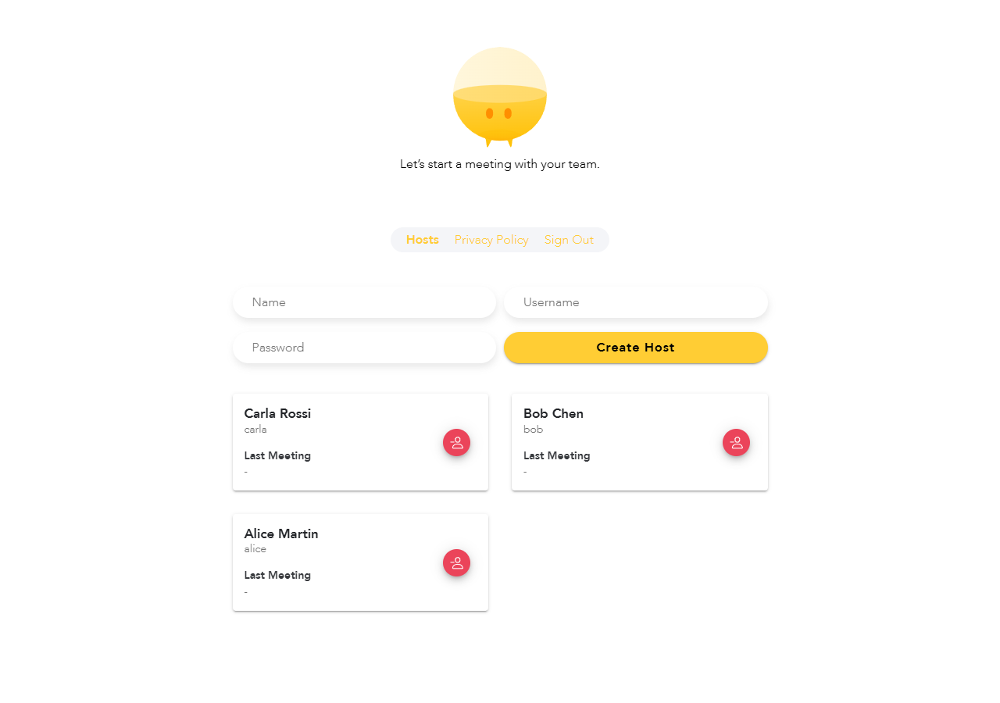<br><b>Hosts</b><br>Last meeting of each host, and delete.</td>
</tr>
</table>

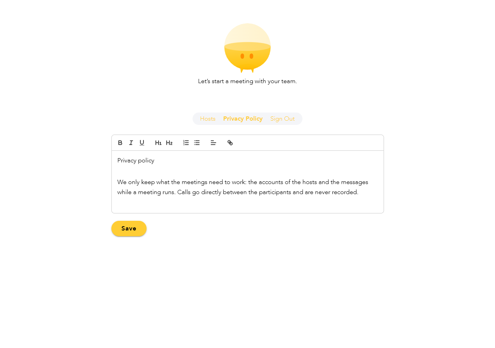

**Privacy policy:** edited here with a small editor, shown at `/privacy` (the HTML is cleaned when it is saved).

### On a phone and on the desktop

The same app runs in the browser, as an installed web app, on Android and iOS (Capacitor) and on the desktop (Electron).
On a small screen the chat opens as a sheet above the menu, and the badge on the chat button counts unread messages.

<p>
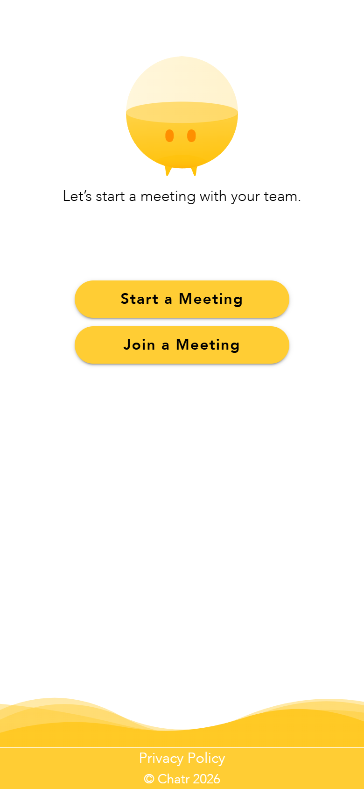
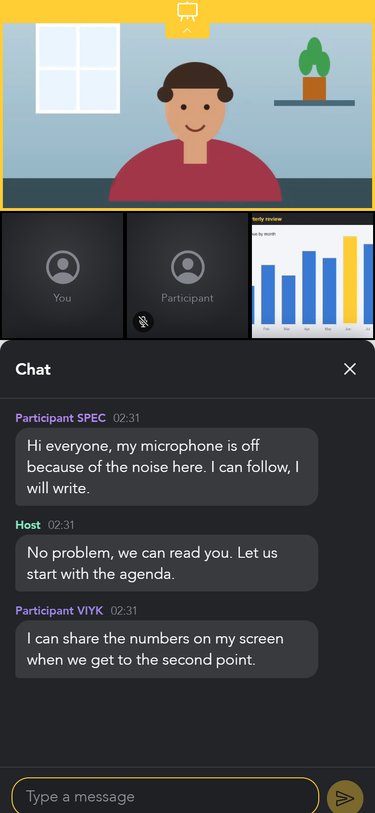
</p>

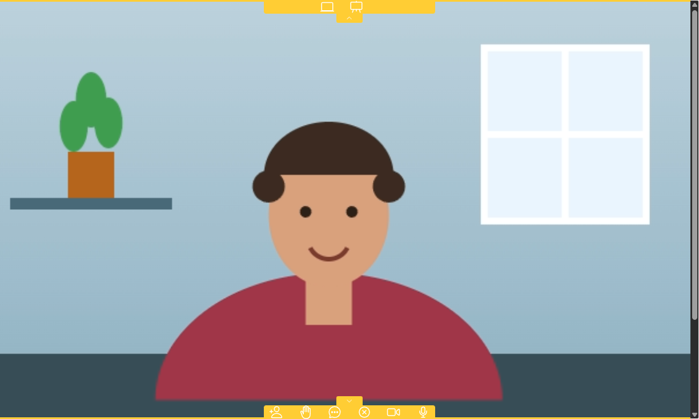

The desktop app (Electron) runs on Windows, macOS and Linux.

The screenshots use made-up names and a drawn camera picture; to retake them, start the app and run the script in
[docs/screenshots/README.md](docs/screenshots/README.md).

---

## Deploy

Two ways, both with HTTPS (needed for cameras and microphones). The step-by-step guides are in [deploy/](deploy/README.md):

- **Cloudflare:** the web app on Cloudflare (free static hosting), the API on any machine with Docker through a Cloudflare Tunnel (nothing to
  open on your network). [Guide](deploy/cloudflare/README.md)
- **Your own server (VPS):** one `docker compose up` for the web app with automatic HTTPS, the API and, if you want, a
  TURN relay for strict networks. [Guide](deploy/vps/README.md)

A server with 1 vCPU and 2 GB of memory is enough to start. The first visit asks you to create the administrator.

## The API

The backend in `api/` is a single Node 26 process (Hono, Drizzle + SQLite, Better Auth, a WebSocket gateway and the WebRTC
signalling). Configuration, security notes, TURN setup and the import of an old database are in
[api/README.md](api/README.md). `.docker-compose.yml` in the root is a development stack behind nginx; for a real
server use [deploy/](deploy/README.md).

## Development

[Bun](https://bun.sh) 1.4+ is the package manager (a `bun.lock` in `api/`, `app/` and `app/electron/`) and runs the
scripts; the API itself runs on Node 26+. The Docker images install Bun themselves, so the server needs neither.

``` cd api && bun install && bun run dev
cd app && bun install && bun run dev ```

Meeting features: voice calls, an optional camera (off until you switch it on), text chat, whiteboard and screen
sharing. The native apps need the camera and microphone permissions declared in their projects (`NSCameraUsageDescription`
and `NSMicrophoneUsageDescription` on iOS, `CAMERA` and `RECORD_AUDIO` on Android). A proposal for noise suppression of the
microphone is in [docs/voice-cancellation.md](docs/voice-cancellation.md).

Development is plain HTTP (`http://localhost:3000` for the app, `http://localhost:8080` for the API, no certificate
needed); production is HTTPS (see [api/README.md](api/README.md)).

The desktop app (Electron) is started with `cd app && bun run desktop:serve`. Its window only allows connections to
the API under a Content Security Policy (`app/electron/src/csp.ts`): `http`/`ws` too while developing, `https`/`wss`
only once packaged.

Or from the repository root: `bun run dev:api` and `bun run dev:app`. Dependency install scripts are not run
(`"trustedDependencies": []` in each `package.json`); add a package there if it really needs one.

## Licence

[MIT](LICENSE): use it, change it and sell it, as long as the copyright notice stays. The open-source packages it
uses keep their own licences ([THIRD-PARTY-LICENSES.md](THIRD-PARTY-LICENSES.md)). The footer of the app shows
`REACT_APP_NAME` and the current year; set your own name there.
